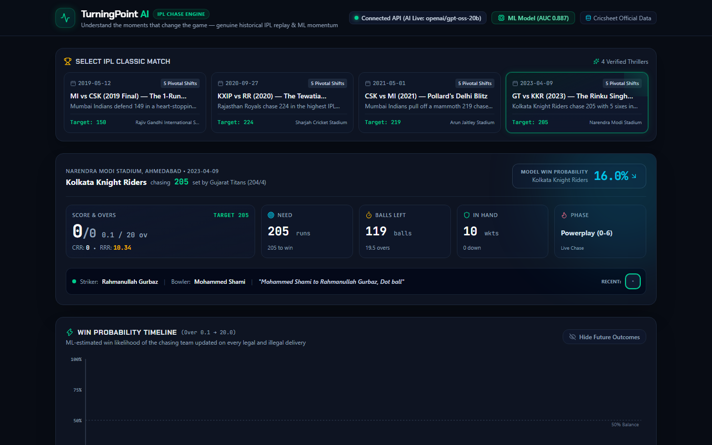
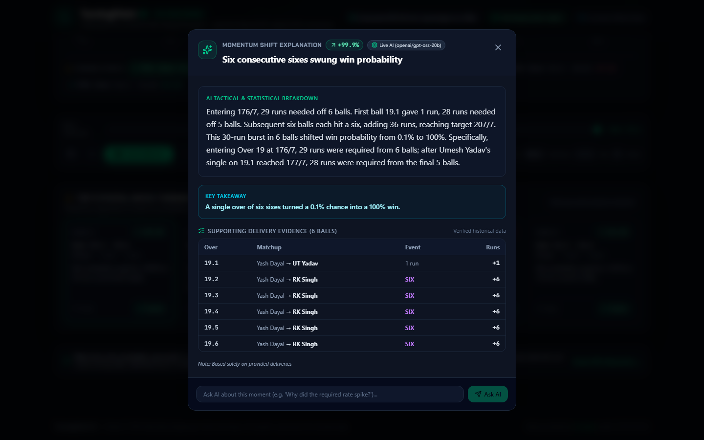
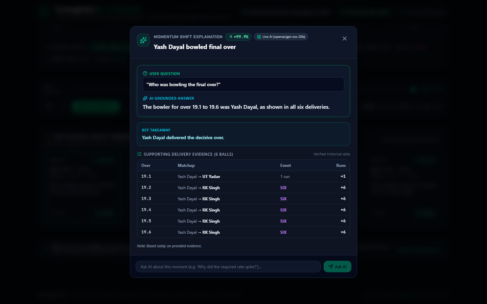

# TurningPoint AI

> **Explainable Match-Momentum Intelligence for T20 Cricket Chases**  
> An end-to-end sports analytics and explainable AI platform that models, detects, and explains win-probability swings across iconic Indian Premier League (IPL) matches using a calibrated machine learning pipeline and evidence-grounded LLM inference.

[](https://frontend-mauve-omega-75.vercel.app)
[](https://turningpoint-ai-backend.onrender.com)
[](https://www.python.org/)
[](https://react.dev/)
[](https://www.typescriptlang.org/)
[](https://fastapi.tiangolo.com/)

---

## 1. Live Demo and Repository Links

- **Production Frontend:** [https://frontend-mauve-omega-75.vercel.app](https://frontend-mauve-omega-75.vercel.app)
- **Production Backend:** [https://turningpoint-ai-backend.onrender.com](https://turningpoint-ai-backend.onrender.com)
- **Interactive API Documentation:** [https://turningpoint-ai-backend.onrender.com/docs](https://turningpoint-ai-backend.onrender.com/docs)
- **GitHub Repository:** [https://github.com/Sodhani0007/turningpoint-ai](https://github.com/Sodhani0007/turningpoint-ai)

---

## 2. Project Overview & Problem Statement

In high-stakes Twenty20 (T20) cricket, match momentum is exceptionally volatile. A single over, a flurry of boundaries, or a sudden double-wicket can shift a match's trajectory in minutes. While standard broadcast graphics display static required run rates or black-box probability gauges, fans and analysts often face unanswered questions:
- *Why did the chasing team's probability collapse so suddenly?*
- *Which specific deliveries caused this swing?*
- *Was the collapse driven by rising required run rate, excessive dot balls, or wickets lost?*
- *Who bowled the decisive over, and how did each ball alter the target equation?*

**TurningPoint AI** addresses these questions directly. It combines a deterministic ball-by-ball cricket parser, a calibrated win-probability model trained on 137,500 historical deliveries, an algorithmic turning-point detector, and an evidence-grounded AI explanation engine. Fans can replay iconic chases delivery-by-delivery, examine mathematically grounded momentum shifts, and ask custom questions answered strictly from verified match evidence.

---

## 3. Key Features

- **Iconic IPL Match Replay:** Delivery-by-delivery second-innings replay for four historic IPL thrillers.
- **Deterministic Cricket State Engine:** Accurate ball accounting strictly adhering to the Laws of Cricket, including extras (wides, no-balls, byes, leg-byes), non-wicket dismissals (retired hurt), and boundary events (fours and sixes).
- **Calibrated ML Win-Probability Model:** Pre-delivery and post-delivery win probability computed via a logistic regression model calibrated with 5-fold cross-validated sigmoid scaling.
- **Algorithmic Turning-Point Detection:** Multi-ball window momentum delta evaluation (1, 3, and 6 balls) with non-maximum suppression (50% overlap pruning) to surface the top 5 pivotal moments per match.
- **Evidence-Grounded AI Explanations:** Natural-language breakdowns generated with strict evidence grounding—prohibiting hallucinated scores, invented player actions, or future match leakage.
- **Interactive Ask AI:** Fans can submit custom questions regarding any turning point (e.g., *"Who was bowling the final over?"*, *"How many sixes were hit?"*), receiving focused, delivery-grounded answers.
- **Dedicated Question-Answer UI Separation:** When users ask a custom question, the interface displays the submitted question distinctly above the AI answer in a dedicated container.
- **Truthful AI Source Attribution:** Explicit source labeling on every explanation:
  - `source: "live_llm"`: Dynamic external inference via Groq (`openai/gpt-oss-20b`).
  - `source: "precomputed_llm"`: Verified model-generated precomputed responses for offline resilience.
  - `source: "deterministic_fallback"`: Algorithmic explanation synthesized from match scorecard events when external providers are unreachable.
- **Model Diagnostics Dashboard:** Dedicated modal inspecting out-of-sample ROC-AUC, Brier score, log loss, calibration curves, and feature definitions.
- **Dual-Mode Architectural Resilience:** Operates with full live API integration when the backend is connected, while seamlessly supporting complete offline replay and precomputed explanations if external services are unavailable.

### Production Dashboard Overview


---

## 4. System Architecture

```
turningpoint-ai/
├── backend/
│   ├── app/
│   │   ├── api/routes.py            # FastAPI endpoints (/health, /matches, /replay, /explain)
│   │   ├── core/config.py           # Configuration, CORS, and provider settings
│   │   ├── models/schemas.py        # Pydantic schemas (DeliveryEvent, TurningPoint, ExplainResponse)
│   │   ├── services/
│   │   │   ├── parser.py            # Deterministic Cricsheet JSON parser & legal ball accountant
│   │   │   ├── ml_model.py          # Win-probability model loader & feature extraction
│   │   │   ├── turning_points.py    # Multi-window swing detector & overlap suppressor
│   │   │   └── explainer.py         # Evidence payload builder, Groq client, & fallback engine
│   │   └── main.py                  # FastAPI application entrypoint
│   ├── data/
│   │   ├── matches/                 # Curated raw Cricsheet JSON match data
│   │   ├── model/                   # Fitted .joblib model, feature schema, and evaluation metrics
│   │   └── precomputed/             # Build-time precomputed match replays and explanations
│   ├── requirements.txt             # Python runtime dependencies
│   └── tests/                       # Automated Pytest suite (19 unit & contract tests)
├── frontend/
│   ├── src/
│   │   ├── components/              # Scoreboard, WinProbChart, ReplayControls, ExplanationModal
│   │   ├── data/                    # Precomputed static bundle fallback
│   │   ├── services/api.ts          # Dual-mode API client (FastAPI live + offline fallback)
│   │   ├── types/cricket.ts         # TypeScript data contracts
│   │   ├── App.tsx                  # Application state & replay controller
│   │   └── main.tsx
│   ├── e2e/                         # Playwright automated browser test suite
│   ├── package.json
│   └── vite.config.ts
├── Dockerfile                       # Production container specification
├── render.yaml                      # Render Blueprint web service definition
├── vercel.json                      # Vercel SPA routing configuration
└── README.md
```

### Data Flow Diagram

```
[ Cricsheet Match JSON ]
           │
           ▼
[ Deterministic Parser ] ───► Legal Ball Accounting & State Reconstruction
           │
           ▼
[ Feature Pipeline ]     ───► 10 Normalized Match-State Features
           │
           ▼
[ Calibrated ML Model ]  ───► Ball-by-Ball Win Probabilities (0.0% - 100.0%)
           │
           ▼
[ Turning Point Detector ]─► Multi-Ball Window Evaluation & Overlap Pruning
           │
           ▼
[ Explanation Engine ]   ───► Evidence Payload Construction (No Future Leakage)
           │
           ├──► [ Live Groq LLM (openai/gpt-oss-20b) ] ──► source: "live_llm"
           ├──► [ Precomputed Model Explanations ]    ──► source: "precomputed_llm"
           └──► [ Deterministic Fact Validator ]      ──► source: "deterministic_fallback"
           │
           ▼
[ React 19 Frontend ]    ───► Replay Dashboard, Win-Prob Chart, Dedicated Q&A Card
```

---

## 5. Technology Stack

| Layer | Technologies | Purpose |
| :--- | :--- | :--- |
| **Frontend** | React 19, TypeScript, Tailwind CSS v4, Vite 6 | High-performance SPA with broadcast-style dark theme |
| **Data Visualization** | Recharts | Responsive win-probability curves and momentum charts |
| **Frontend Testing** | Playwright | End-to-end browser and mobile test automation |
| **Backend Framework** | FastAPI, Uvicorn, Pydantic v2 | High-throughput asynchronous REST API |
| **Machine Learning** | scikit-learn, pandas, NumPy, joblib | Feature extraction, logistic regression, and sigmoid calibration |
| **AI / LLM Provider** | Groq Cloud (`openai/gpt-oss-20b`) | Evidence-grounded natural-language explanations and Q&A |
| **Backend Testing** | Pytest, HTTPX | Unit tests, contract verification, and factual checks |
| **Hosting & Deployment**| Vercel (Frontend), Render (Backend) | Globally distributed frontend and cloud web service |

---

## 6. Machine Learning Methodology

### Model Architecture
- **Base Estimator:** Standard-scaled Logistic Regression (`C=1.0`, `max_iter=1000`, `solver='lbfgs'`).
- **Probability Calibration:** `CalibratedClassifierCV` using 5-fold cross-validated sigmoid scaling to produce calibrated probability outputs.
- **Terminal State Constraints:** Explicit boundary assignment:
  - When chasing team scores $\ge \text{target}$: win probability is set to $1.0$ ($100\%$).
  - When chasing team is all out or deliveries expire with $\text{score} < \text{target}$: win probability is set to $0.0$ ($0\%$).

### Feature Set (10 Core Match-State Signals)
1. `target_runs`: Target score set in the first innings plus one run.
2. `score`: Current total runs scored by the chasing team.
3. `wickets_lost`: Cumulative wickets lost in the second innings ($0$ to $10$).
4. `legal_balls_bowled`: Count of completed legal deliveries ($0$ to $120$).
5. `balls_remaining`: Legal deliveries remaining in the chase ($120 - \text{legal\_balls\_bowled}$).
6. `runs_required`: Remaining runs needed to win ($\text{target\_runs} - \text{score}$).
7. `current_run_rate`: Current scoring rate per 6 legal balls.
8. `required_run_rate`: Required scoring rate per 6 legal balls (capped at 36.0 to avoid unbounded infinity on low ball counts).
9. `wickets_remaining`: Remaining wickets in hand ($10 - \text{wickets\_lost}$).
10. `recent_run_rate`: Rolling scoring rate across the preceding 12 legal balls.

### Chronological Train / Validation / Test Split
To prevent data leakage across cricket eras and maintain realistic generalization:
- **Training Set (IPL Seasons $\le$ 2021):** 96,462 legal delivery states across 839 matches.
- **Validation Set (IPL Season 2022):** 8,619 legal delivery states across 74 matches.
- **Out-of-Sample Test Set (IPL Seasons $\ge$ 2023):** 32,419 legal delivery states across 282 matches.

---

## 7. Turning-Point Detection Algorithm

Turning points are automatically identified by analyzing the second-innings win-probability trajectory:

1. **Multi-Window Candidate Generation:**
   - Evaluates probability deltas ($\Delta P = P_{\text{after}} - P_{\text{before}}$) across multi-ball windows of size $W \in \{1, 3, 6\}$ legal deliveries.
2. **Significance Thresholding:**
   - Filters out minor fluctuations by enforcing a minimum probability swing threshold of $|\Delta P| \ge 0.06$ ($6\%$).
3. **Candidate Ranking:**
   - Sorts candidate segments in descending order of absolute swing magnitude ($|\Delta P|$).
4. **Non-Maximum Suppression (Overlap Pruning):**
   - Computes delivery index intersection between candidate windows:
     $$\text{Overlap Ratio} = \frac{|Window_A \cap Window_B|}{\min(|Window_A|, |Window_B|)}$$
   - If overlap exceeds $0.50$ ($50\%$), the lower-ranked candidate is suppressed to ensure distinct, non-redundant match phases.
5. **Top Moments Selection:**
   - The top 5 non-overlapping moments are indexed per match with exact over labels, entering scores, runs required, and supporting delivery IDs.

---

## 8. AI Explanations and Ask AI Implementation

### Architecture and Evidence Grounding
The explanation engine synthesizes structured match data into clear, human-readable commentary:
- **Bounded Evidence Contract:** The LLM prompt receives strictly bounded historical facts: match context, teams, entering score, required run rate, ending score, and the exact deliveries bowled during that phase.
- **Anti-Hallucination Constraints:** System instructions explicitly prohibit inventing players, bowling figures, or match outcomes. The model cannot reference events occurring after the turning point window.
- **Delivery Validation:** Supporting delivery IDs returned by the model are deterministically validated against the match record.

### Truthful Source Attribution
Every explanation payload contains a `source` tag:
1. `live_llm`: Dynamic response generated by Groq (`openai/gpt-oss-20b`), providing real-time inference and answering custom prompts.
2. `precomputed_llm`: Pre-generated explanation derived from the verified model pipeline for instant offline replay.
3. `deterministic_fallback`: Factual explanation generated algorithmically from match events if the external provider times out or errors.



### Ask AI Custom Question Answering
The Ask AI interface allows users to submit targeted analytical questions about any selected turning point:
- **Focused Prompting:** When a custom question is entered, the engine switches to a specialized Q&A prompt instructing the model to answer the specific query directly (e.g., identifying bowler names, boundary sequences, or strategic shifts) using the verified delivery records.
- **Dedicated Question-Answer UI Separation:**
  - The submitted question is rendered in a dedicated `user-qa-card` above the delivery breakdown.
  - The question text (`data-testid="user-question-text"`) is displayed distinctly from the generated answer (`data-testid="user-answer-text"`).
- **Graceful Error Handling:** If an external inference error occurs during a custom question, the UI displays a clear alert (`data-testid="qa-error-alert"`) rather than silently substituting the generic turning-point explanation.
- **Independent Explain Shift:** The default "Explain Shift" button remains completely independent and continues to provide the comprehensive phase overview.



---

## 9. Supported Historical Matches

The application includes four curated, iconic IPL chases parsed from raw Cricsheet data:

| Match ID | Match Details | Venue & Date | Iconic Turning Point |
| :--- | :--- | :--- | :--- |
| **1359487** | **GT vs KKR (2023)**<br>GT 204/4 vs KKR 207/7 | Ahmedabad<br>April 9, 2023 | **Rinku Singh's 5 Consecutive Sixes:** Entering Over 19 at 176/7 (0.1% win prob), Rinku Singh strikes 5 consecutive sixes off Yash Dayal to chase down 29 runs in the final over. |
| **1181768** | **MI vs CSK (2019 Final)**<br>MI 149/8 vs CSK 148/7 | Hyderabad<br>May 12, 2019 | **Malinga's Final-Ball Yorker:** Lasith Malinga defends 9 runs in the 20th over, trapping Shardul Thakur LBW on the final ball to win the title by 1 run. |
| **1216527** | **KXIP vs RR (2020)**<br>KXIP 223/2 vs RR 226/6 | Sharjah<br>September 27, 2020 | **Rahul Tewatia's 5 Sixes:** Chasing 224 (highest successful IPL chase), Tewatia hits 5 sixes in the 18th over off Sheldon Cottrell to swing probability from 14% to 88%. |
| **1254084** | **CSK vs MI (2021)**<br>CSK 218/4 vs MI 219/6 | Delhi<br>May 1, 2021 | **Kieron Pollard's Final-Ball Blitz:** Chasing 219, Pollard smashes 87* off 34 balls, striking 2 runs off the final delivery by Lungi Ngidi. |

---

## 10. Local Setup and Installation

Follow these instructions to set up and run the application locally on Windows (PowerShell) or macOS/Linux.

### Prerequisites
- **Node.js:** $\ge$ 20.x
- **Python:** $\ge$ 3.12 (tested on 3.12 - 3.14)
- **Git**

### 1. Clone the Repository
```powershell
git clone https://github.com/Sodhani0007/turningpoint-ai.git
cd turningpoint-ai
```

### 2. Backend Setup (FastAPI)
```powershell
# Create and activate Python virtual environment
python -m venv backend_venv
.\backend_venv\Scripts\Activate.ps1

# Install backend dependencies
pip install -r backend/requirements.txt

# Run backend test suite (19 tests)
$env:PYTHONPATH="."
pytest backend/tests -v

# (Optional) Set your Groq API key for live AI explanations
$env:GROQ_API_KEY="gsk_your_api_key_here"
$env:GROQ_MODEL="openai/gpt-oss-20b"

# Start the FastAPI server
uvicorn backend.app.main:app --host 0.0.0.0 --port 8000 --reload
```
The FastAPI backend will be active at `http://localhost:8000`.  
Interactive Swagger documentation is available at `http://localhost:8000/docs`.

### 3. Frontend Setup (React + Vite)
Open a new terminal window from the repository root:
```powershell
cd frontend

# Install frontend dependencies
npm install

# Run TypeScript check and production build
npm run build

# Run Ask AI Playwright verification tests
npx playwright test e2e/ask_ai_questions.spec.ts

# Start the Vite development server
npm run dev
```
The frontend will be running at `http://localhost:5173`.  
Vite automatically proxies `/api` requests to `http://127.0.0.1:8000`.

---

## 11. Environment Variables

Create a `.env` file in `backend/` or configure environment variables directly:

| Variable | Description | Default / Example | Required |
| :--- | :--- | :--- | :--- |
| `GROQ_API_KEY` | API key for Groq Cloud inference | `gsk_...` | Optional (Required for live LLM / Ask AI) |
| `GROQ_MODEL` | Groq model identifier | `openai/gpt-oss-20b` | Optional |
| `GROQ_BASE_URL` | Groq API base URL | `https://api.groq.com/openai/v1` | Optional |
| `ALLOWED_ORIGINS` | Comma-separated CORS allowed origins | `https://frontend-mauve-omega-75.vercel.app` | Optional |
| `VITE_API_URL` | Frontend API backend URL | `https://turningpoint-ai-backend.onrender.com` | Optional (Defaults to local `/api` proxy) |

> **Dual-Mode Operation:** If `GROQ_API_KEY` is not provided, the application automatically uses verified precomputed explanations and deterministic fallbacks. The replay interface and ML win-probability model function fully without any external API keys.

---

## 12. Testing and Verification

The repository maintains automated test suites across both backend and frontend:

### Backend Test Suite (`pytest backend/tests -v`)
- **19 passed tests** covering:
  - `/api/health` system and model verification
  - Match metadata, replay, and summary endpoint schemas
  - Deterministic Cricsheet parsing (extras, non-wicket dismissals, legal ball counting)
  - Win-probability model inference and feature extraction
  - Turning-point detection and overlap suppression
  - Groq payload construction, token budgeting, and JSON validation
  - Ask AI prompt grounding and user question propagation
  - Deterministic fallback and factual disambiguation

### Frontend Automated Testing (`npx playwright test`)
- **4 passed tests** across Chromium and Mobile viewports covering:
  - Custom question handling for three distinct queries:
    1. *"Why did KKR's win probability increase in the final over?"*
    2. *"How many sixes did Rinku Singh hit in the final five balls?"*
    3. *"Who was bowling the final over?"*
  - Dedicated User Question & AI Grounded Answer card (`data-testid="user-qa-card"`) rendering
  - Error banner display (`data-testid="qa-error-alert"`) on inference failure
  - Independent default "Explain Shift" modal functionality

### Frontend Build Verification (`npm run build`)
- Full TypeScript type-checking (`tsc -b`) and Vite production bundle generation with 0 errors.

---

## 13. Model Evaluation Results

Evaluation performed strictly on the out-of-sample test set (IPL Seasons $\ge$ 2023, 32,419 delivery states):

| Metric | Measured Value | Technical Interpretation |
| :--- | :--- | :--- |
| **ROC-AUC** | **0.8870** | Strong discriminative ability between eventual winning and losing chase states across diverse match situations. |
| **Brier Score** | **0.1436** | Mean squared error between predicted probabilities and actual binary match outcomes (ranging from 0 to 1, where lower values indicate superior probabilistic accuracy). |
| **Log Loss** | **0.4357** | Well-penalized cross-entropy loss against out-of-sample match results without extreme confidence mispredictions. |

> **Note on Probabilities:** All precomputed probabilities displayed in the application are legitimate outputs computed by this trained scikit-learn model, not fabricated numbers or arbitrary heuristics.

---

## 14. Demonstration Walkthrough

Reviewers can follow this quick walkthrough to experience the key features:

1. **Open the Application:** Navigate to [https://frontend-mauve-omega-75.vercel.app](https://frontend-mauve-omega-75.vercel.app).
2. **Select Match:** Choose **GT vs KKR (2023)** from the match selector.
3. **Inspect Turning Points:** Click on the **Rank #1 Turning Point** card (`Over 19.1 - 19.6`). The replay scrubber jumps to the start of the 20th over (176/7, 29 runs needed from 6 balls, 0.1% win probability).
4. **Replay the Over:** Click **Play** at **2x Speed** to watch the scrubber and ball ticker advance as Rinku Singh strikes 5 consecutive sixes off Yash Dayal, culminating in a 100.0% win probability on 19.6.
5. **Open Explain Shift:** Click the **"Explain"** button on the turning point card. View the grounded breakdown, probability delta (+99.9%), and supporting delivery events.
6. **Ask a Custom Question:** In the Ask AI input, type:
   > *"Who was bowling the final over?"*
7. **Verify Contextual Q&A:** Click **Ask AI**. Observe the dedicated **User Question & AI Grounded Answer** card displaying your question and the answer identifying **Yash Dayal**.
8. **Inspect ML Diagnostics:** Click **"ML Model (AUC 0.887)"** in the top navigation bar to examine the model's out-of-sample metrics, Brier score, and calibration curves.

---

## 15. Limitations & Future Roadmap

| Area | Current Implementation | Future Roadmap |
| :--- | :--- | :--- |
| **Match Ingestion** | Curated historical Cricsheet JSON matches | Live ball-by-ball ingestion via WebSockets / sports radar APIs |
| **Innings Scope** | Second-innings run chase modeling | First-innings par-score and target distribution modeling |
| **Environmental Features** | Match state & rolling run rates | Incorporation of venue dimensions, pitch condition, and dew factors |
| **Model Architecture** | Calibrated Logistic Regression | Gradient Boosted Trees (LightGBM) & ball-by-ball neural sequence models |
| **Streaming Explanations**| Bounded JSON responses via Groq | Token-streaming explanations with audio commentary synthesis |

---

## 16. Data Sources, Attribution, and AI Development Disclosure

### Data Sources & Licensing
- **Cricsheet ([cricsheet.org](https://cricsheet.org)):** Ball-by-ball IPL match data used under the [Creative Commons Attribution-ShareAlike 4.0 International License (CC BY-SA 4.0)](https://creativecommons.org/licenses/by-sa/4.0/).
- **Analytics References:** Inspired by cricket analytics methodologies established in open-source cricket research and community probabilistic modeling.

### AI Development & Transparency Disclosure
- **Pair Programming & Scaffolding:** Developed with the assistance of Google Antigravity (powered by Gemini) for architectural scaffolding, TypeScript/Python schema alignment, test suite generation, and documentation review.
- **Machine Learning Integrity:** The win-probability model is a genuine scikit-learn model trained locally on 137,500 real IPL deliveries with chronological season splitting; no artificial or fabricated probabilities are used.
- **Explanation Grounding:** All AI explanations operate under strict bounding constraints to ensure statements reflect historical match events without hallucinated actions or future leakage.
